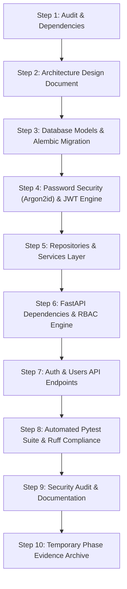

# OptiGuide — Phase 2 Pre-Implementation Audit
## Authentication, Authorization & User Management Architecture

**Platform:** OptiGuide Preliminary Vision Screening and Eyewear Guidance  
**Author:** Principal Backend Architect & Application Security Engineer  
**Date:** November 3, 2026  
**Status:** COMPLETE (Pre-Implementation Baseline Verified)  
**Document Path:** `docs/backend/PHASE_2_PRE_IMPLEMENTATION_AUDIT.md`  

---

## 1. Executive Summary

This pre-implementation audit inspects the current OptiGuide codebase (following completion of Phase 1 and Phase 1.1) to establish the architectural blueprint for **Phase 2: Authentication, Authorization & User Management**.

Phase 1 established:
- FastAPI modular application factory and versioned router aggregator (`/api/v1`).
- Centralized `pydantic-settings` with type parsing and CORS origin handling.
- SQLAlchemy 2.0 ORM engine, session lifecycle with dependency injection, and Alembic migration framework (`001_initial_baseline.py`).
- Isolated test architecture via in-memory SQLite `StaticPool` and FastAPI `dependency_overrides`.
- Uniform RFC-compliant error envelopes (`{"error": {"code": "...", "message": "...", "details": [...]}}`).
- Cleaned logging pipeline with `SanitizingFilter` and regex credential redaction.
- 36 passing automated tests and zero Ruff linter errors.

Phase 2 will introduce:
- Declarative SQLAlchemy models: `User` and `UserSession` (persistent refresh tokens).
- Argon2id password hashing using `argon2-cffi`.
- Asymmetric/symmetric signed JWT access tokens and persistent refresh token rotation using `pyjwt`.
- Comprehensive session management with session revocation (logout and logout-all).
- Fine-grained Role-Based Access Control (RBAC): `patient`, `optometrist`, `shopkeeper`, `admin`.
- Authentication API endpoints under `/api/v1/auth/` and user profile endpoints under `/api/v1/users/`.
- Alembic migration revision `002_user_and_auth.py`.
- Automated unit, integration, and security test suites.

---

## 2. Existing Architecture & Code Review

### 2.1 Backend Structure
```
backend/
├── app/
│   ├── main.py                  # FastAPI app factory, CORS, exception handlers
│   ├── api/
│   │   ├── dependencies.py      # Core dependency injection (get_db, get_database)
│   │   └── v1/
│   │       ├── router.py        # Aggregator router for /api/v1
│   │       └── health.py        # /health, /health/database, /health/db endpoints
│   ├── core/
│   │   ├── config.py            # Settings (Pydantic BaseSettings)
│   │   ├── logging.py           # Logging setup with SanitizingFilter
│   │   └── exceptions.py        # OptiGuideException hierarchy
│   ├── database/
│   │   ├── base.py              # DeclarativeBase
│   │   ├── session.py           # Engine, SessionLocal, get_db, check_db_connectivity
│   │   └── init_db.py           # Schema initialization for testing/dev
│   ├── models/
│   │   └── __init__.py          # Base export (empty domain model list)
│   ├── schemas/
│   │   ├── common.py            # Generic PaginatedResponse[T]
│   │   ├── error.py             # ErrorResponse, ApiErrorPayload, ErrorDetail
│   │   └── health.py            # AppInfoResponse, HealthResponse, DatabaseHealthResponse
│   ├── repositories/            # Empty placeholder for data access abstraction
│   ├── services/                # Empty placeholder for business logic
│   ├── middleware/
│   │   ├── error_handler.py     # Global exception handlers (422, 404, 500)
│   │   └── logging_middleware.py# Timing middleware (X-Process-Time-Ms)
│   └── utils/                   # Empty utility directory
├── migrations/
│   ├── env.py                   # Alembic environment with runtime sys.path
│   └── versions/
│       └── 001_initial_baseline.py  # Empty initial baseline revision
├── tests/                       # 36 passing unit, integration, and API tests
└── alembic.ini                  # Alembic CLI configuration
```

### 2.2 Existing Authentication-Related Artifacts
- **Shared Types (`shared/types/user.ts`):**
  Defines `UserRole = 'patient' | 'optometrist' | 'shopkeeper' | 'admin'`, `UserProfile`, and `AuthSession`.
- **Shared Validation (`shared/validation/user.ts`):**
  Defines client-side regex for email validation and password minimum length (8 characters).
- **Backend Models (`backend/app/models/`):**
  Currently contains no domain models. `backend/app/models/__init__.py` exports only `Base`.
- **Alembic History:**
  Single empty baseline revision `001_initial_baseline.py`. `alembic_version` table is active.

---

## 3. Database Compatibility Analysis

### 3.1 Dual-Dialect Support (PostgreSQL and SQLite)
- **Primary Server Engine:** PostgreSQL (tested via `psycopg` 3.x in CI).
- **Local Dev & Testing:** SQLite (in-memory `StaticPool` during Pytest; `sqlite:///./local_dev.db` for zero-dependency local runs).
- **Dialect Discrepancies & Solutions:**
  - **UUIDs:** PostgreSQL has a native `UUID` type; SQLite stores UUIDs as `VARCHAR(36)`. We will use `sqlalchemy.types.Uuid(as_uuid=True)` which transparently compiles to native UUID on PostgreSQL and CHAR(32)/VARCHAR(36) on SQLite.
  - **Timestamps:** PostgreSQL supports `TIMESTAMP WITH TIME ZONE`; SQLite stores timestamps as ISO strings or integers. We will use `sqlalchemy.DateTime(timezone=True)` with explicit `datetime.now(UTC)` python defaults to ensure timezone awareness across both engines.
  - **Booleans:** Native on PostgreSQL, integer (0/1) on SQLite; transparently handled by `sqlalchemy.Boolean`.
  - **Indexes & Unique Constraints:** Both engines support `unique=True` and `index=True` on `email` and `token_hash`.

---

## 4. Frontend Integration Requirements

### 4.1 Shared Type Contract Alignment
Inspecting `shared/types/user.ts`:
```typescript
export type UserRole = 'patient' | 'optometrist' | 'shopkeeper' | 'admin';

export interface UserProfile {
  id: string;
  email: string;
  fullName: string;
  role: UserRole;
  phoneNumber?: string;
  preferredLanguage: string;
  createdAt: string;
  updatedAt: string;
}

export interface AuthSession {
  accessToken: string;
  refreshToken: string;
  tokenType: string;
  expiresIn: number;
  user: UserProfile;
}
```

### 4.2 API Contract Design Decision (Snake Case vs Camel Case)
In FastAPI / Python, standard field naming is snake_case (`full_name`, `access_token`, `token_type`, `expires_in`, `preferred_language`).
To ensure seamless compatibility with standard JavaScript/TypeScript camelCase conventions without breaking Python PEP 8 conventions:
- Pydantic models will provide an aliasing configuration (`populate_by_name=True`) supporting both `full_name` and `fullName` in request payloads, and serializing with standard `camelCase` or snake_case matching the frontend `AuthSession` interface.
- Standard OAuth2 token responses (`access_token`, `refresh_token`, `token_type`, `expires_in`) will be included to ensure standard RFC 6749 compliance.

---

## 5. Security Gap Analysis & Baseline Hardening

| Area | Current Phase 1 Baseline | Phase 2 Requirement | Architectural Solution |
|---|---|---|---|
| **Password Storage** | None | Argon2id hashing | Use `argon2-cffi` `PasswordHasher(time_cost=3, memory_cost=65536, parallelism=4)` |
| **Token Authentication** | None | Short-lived JWT (15 min) | Sign with `pyjwt`, secret from `JWT_SECRET_KEY`, algorithm `HS256`, reject expired/malformed |
| **Refresh Tokens** | None | Rotated, revocable refresh tokens | Store SHA-256 hash of refresh token in `user_sessions` table; rotate on every `/refresh` |
| **Reuse Detection** | None | Revoke all sessions on reuse | If a rotated/revoked refresh token is presented, invalidate all sessions for that user |
| **Brute Force / Rate Limit** | None | Rate limit auth endpoints | Implement in-memory/sliding window rate limiter dependency on `/login` and `/register` |
| **Information Disclosure** | Generic error handlers active | Generic auth failures | Return `"Invalid email or password"` for all failed logins; never reveal user existence |
| **Role Authorization** | None | Enforce RBAC dependencies | `require_roles("admin", "optometrist")`, `require_active_user` |

---

## 6. Files Requiring Modification & Creation

### 6.1 Files to Modify
1. `backend/pyproject.toml` — Add `argon2-cffi>=23.1.0`, `pyjwt>=2.8.0`, `email-validator>=2.1.0`.
2. `backend/requirements.txt` — Pin new dependencies.
3. `backend/.env.example` — Add JWT and security settings.
4. `backend/README.md` — Document authentication endpoints, roles, and security settings.
5. `backend/app/core/config.py` — Add `JWT_SECRET_KEY`, `JWT_ALGORITHM`, `ACCESS_TOKEN_EXPIRE_MINUTES`, `REFRESH_TOKEN_EXPIRE_DAYS`, `JWT_ISSUER`, `JWT_AUDIENCE`, `PASSWORD_MIN_LENGTH`.
6. `backend/app/core/exceptions.py` — Add `AuthenticationException`, `ForbiddenException`, `TokenRevokedException`, `TokenExpiredException`.
7. `backend/app/models/__init__.py` — Register `User` and `UserSession` declarative models.
8. `backend/app/api/dependencies.py` — Add `get_current_user`, `get_current_active_user`, `require_role`, `rate_limiter`.
9. `backend/app/api/v1/router.py` — Register `auth.router` and `users.router`.

### 6.2 Files to Create
1. `backend/app/models/user.py` — SQLAlchemy `User` ORM entity with enum role and timestamps.
2. `backend/app/models/session.py` — SQLAlchemy `UserSession` ORM entity for refresh tokens.
3. `backend/app/core/security.py` — Argon2id password utilities and JWT token generator/validator.
4. `backend/app/schemas/auth.py` — Registration, Login, Token, Session, and User Pydantic v2 schemas.
5. `backend/app/repositories/user_repo.py` — User data access layer (CRUD, by-email query).
6. `backend/app/repositories/session_repo.py` — Session data access layer (create, rotate, revoke).
7. `backend/app/services/auth_service.py` — Authentication domain logic (register, login, refresh, logout).
8. `backend/app/services/user_service.py` — User profile domain logic (update profile, list sessions).
9. `backend/app/api/v1/auth.py` — `/api/v1/auth/` endpoints (register, login, refresh, logout, logout-all, me).
10. `backend/app/api/v1/users.py` — `/api/v1/users/` endpoints (get profile, patch profile, get sessions).
11. `backend/migrations/versions/002_user_and_auth.py` — Alembic revision for `users` and `user_sessions` tables.
12. `backend/tests/unit/test_security_auth.py` — Unit tests for Argon2id hashing and JWT decoding.
13. `backend/tests/api/test_auth_api.py` — API tests for registration, login, refresh, logout, me.
14. `backend/tests/api/test_users_api.py` — API tests for user profile and session listing.
15. `backend/tests/integration/test_auth_integration.py` — Integration tests for session persistence and token rotation.
16. `docs/backend/PHASE_2_AUTHENTICATION_DESIGN.md` — Formal architecture design specification.
17. `docs/backend/PHASE_2_SECURITY_AUDIT.md` — Comprehensive security review.
18. `docs/backend/PHASE_2_COMPLETION_REPORT.md` — Phase 2 completion artifact.
19. `docs/phase-reports/PHASE_2_REPORT.md` — Phase report.

---

## 7. Implementation Strategy & Rollout Plan



---

## 8. Risks & Backward Compatibility Considerations

1. **Database Schema Evolution:**
   The `001_initial_baseline.py` migration was empty. The `002_user_and_auth.py` migration will cleanly create the `users` and `user_sessions` tables forward-only without dropping or conflicting with existing structures.
2. **Phase 1 Test Suite Integrity:**
   All 36 existing tests in `backend/tests/` must continue to pass without modification.
3. **Database Test Isolation:**
   New authentication tests must leverage the existing SQLite in-memory `StaticPool` test engine to ensure that test users and test sessions are completely isolated and cleaned up automatically.
4. **Token Security:**
   Plaintext refresh tokens will never be stored in the database. Instead, only a SHA-256 cryptographic hash of the refresh token will be persisted in `user_sessions`. If a database is ever compromised, stored refresh tokens cannot be used to forge session access.
