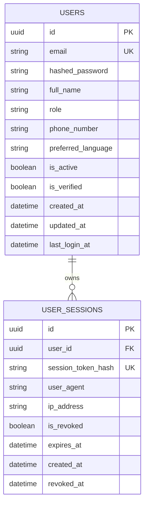

# OptiGuide — Phase 2 Authentication Design Specification
## Secure Architecture for Authentication, Authorization & Session Management

**Platform:** OptiGuide Preliminary Vision Screening and Eyewear Guidance  
**Author:** Principal Backend Architect & Application Security Engineer  
**Date:** November 3, 2026  
**Status:** APPROVED ARCHITECTURE  
**Document Path:** `docs/backend/PHASE_2_AUTHENTICATION_DESIGN.md`  

---

## 1. Architectural Principles

1. **Defense in Depth:** Multi-tiered defense across password hashing, cryptographic token signing, short access token lifespan, hashed refresh token storage, and runtime permission verification.
2. **Zero Information Leakage:** Generic authentication responses to prevent user enumeration attacks. Masked logging across all authentication payloads.
3. **Stateless Access with Stateful Invalidation:** Short-lived JWT access tokens (15 minutes) for high-performance stateless verification, paired with database-backed refresh token sessions allowing instantaneous revocation and logout.
4. **Strict Token Rotation & Reuse Detection:** Every refresh operation invalidates the presented refresh token and issues a new pair. If a revoked or previously rotated token is presented, the system treats it as an attack and immediately revokes all active sessions for that user account.
5. **Portability & Isolation:** Native support for both PostgreSQL (production) and SQLite (testing and local development).

---

## 2. Data Models & Entity Relationships



### 2.1 User Model (`backend/app/models/user.py`)
- `id`: `UUID` (Primary Key, default: `uuid.uuid4`).
- `email`: `String(255)` (Unique, Indexed, lowercased, validated).
- `hashed_password`: `String(255)` (Argon2id format `$argon2id$v=19$m=65536,t=3,p=4$...`).
- `full_name`: `String(255)` (User's display name).
- `role`: `String(50)` (Values: `patient`, `optometrist`, `shopkeeper`, `admin`).
- `phone_number`: `String(50)` (Optional).
- `preferred_language`: `String(10)` (Default: `en`).
- `is_active`: `Boolean` (Default: `True`).
- `is_verified`: `Boolean` (Default: `False`).
- `created_at`: `DateTime(timezone=True)` (Default: `UTC.now`).
- `updated_at`: `DateTime(timezone=True)` (Default: `UTC.now`, onupdate: `UTC.now`).
- `last_login_at`: `DateTime(timezone=True)` (Optional, updated on successful login).

### 2.2 UserSession Model (`backend/app/models/session.py`)
- `id`: `UUID` (Primary Key, default: `uuid.uuid4`).
- `user_id`: `UUID` (Foreign Key referencing `users.id`, ondelete: `CASCADE`, Indexed).
- `session_token_hash`: `String(64)` (SHA-256 hash of refresh token secret, Unique, Indexed).
- `user_agent`: `String(512)` (Optional client device summary).
- `ip_address`: `String(45)` (Optional client IP coordinate).
- `is_revoked`: `Boolean` (Default: `False`, Indexed).
- `expires_at`: `DateTime(timezone=True)` (Timestamp when refresh token expires).
- `created_at`: `DateTime(timezone=True)` (Default: `UTC.now`).
- `revoked_at`: `DateTime(timezone=True)` (Timestamp when revoked).

---

## 3. Cryptographic & Token Specifications

### 3.1 Argon2id Password Hashing
Password security leverages `argon2-cffi` configured with OWASP-recommended parameters:
- Algorithm: `Argon2id` (version 19).
- Memory cost: 64 MB ($65,536$ KiB).
- Time cost (iterations): 3 passes.
- Parallelism: 4 lanes/threads.
- Salt: 16 cryptographically random bytes generated automatically by the hasher.
- Hash length: 32 bytes.

### 3.2 JWT Access Tokens
Access tokens are signed using HMAC-SHA256 (`HS256`) with a cryptographically random secret read from `JWT_SECRET_KEY`.
- Payload Claims:
  - `sub`: User UUID string.
  - `email`: Normalized email string.
  - `role`: User role (`patient`, `optometrist`, `shopkeeper`, `admin`).
  - `type`: `"access"`.
  - `jti`: Unique token UUID.
  - `iss`: Issuer (`optiguide-api`).
  - `aud`: Audience (`optiguide-client`).
  - `iat`: Timestamp of issuance (epoch seconds).
  - `exp`: Timestamp of expiration (epoch seconds; `iat + 15 minutes`).

### 3.3 Refresh Tokens & Session Rotation
- Format: High-entropy URL-safe base64 string ($256$ bits of entropy via `secrets.token_urlsafe(32)`).
- Storage: The raw refresh token is transmitted to the client and never saved to the database in plaintext. Instead, the server computes:
  $$\text{token\_hash} = \text{SHA-256}(\text{raw\_refresh\_token})$$
- Verification: On `/refresh`, the client provides the raw refresh token. The server hashes it and performs an indexed lookup against `user_sessions`.
- Rotation:
  1. If found, active, and unexpired:
     - Mark current session `is_revoked = True`, `revoked_at = UTC.now()`.
     - Issue a brand new refresh token and create a new session record.
     - Issue a brand new access token.
  2. If found but `is_revoked == True` (**Reuse Detection**):
     - Treat as token theft / replay attack.
     - Immediately revoke **all active sessions** for that `user_id`.
     - Return HTTP 401 Unauthorized with error code `TOKEN_REVOKED`.

---

## 4. Role-Based Access Control (RBAC) Matrix

OptiGuide defines four distinct operational roles:

| Role | Description | Permissions |
|---|---|---|
| `patient` | Individual taking vision screenings | Take screenings, view own visual acuity reports, receive eyewear suggestions |
| `optometrist` | Licensed eye-care professional | Review preliminary screenings, confirm prescriptions, issue clinical notes |
| `shopkeeper` | Optical retail staff | Access approved frame recommendations, match physical inventory |
| `admin` | System administrator | User activation/deactivation, audit log inspection, system maintenance |

### Dependency Hierarchy
- `get_current_user`: Extracts and validates JWT from `Authorization: Bearer <token>`. Queries user from DB. Rejects deactivated users.
- `get_current_active_user`: Enforces `user.is_active is True`.
- `require_roles(*roles: str)`: Enforces `user.role in roles`, returning HTTP 403 Forbidden with `FORBIDDEN` code if unauthorized.
- `require_admin`: Convenience alias for `require_roles("admin")`.

---

## 5. API Endpoints Specification

### 5.1 Authentication Endpoints (`/api/v1/auth`)

| Method | Endpoint | Description | Request Body | Response Body | Auth Required |
|---|---|---|---|---|---|
| `POST` | `/api/v1/auth/register` | Register new user account | `UserRegisterRequest` | `AuthResponse` | No (Rate-limited) |
| `POST` | `/api/v1/auth/login` | Authenticate user and issue tokens | `UserLoginRequest` | `AuthResponse` | No (Rate-limited) |
| `POST` | `/api/v1/auth/refresh` | Rotate refresh token and issue new access token | `TokenRefreshRequest` | `TokenRefreshResponse` | No |
| `POST` | `/api/v1/auth/logout` | Revoke current active refresh session | `TokenRefreshRequest` | `MessageResponse` | Optional Bearer |
| `POST` | `/api/v1/auth/logout-all` | Revoke all active sessions for current user | None | `MessageResponse` | Bearer |
| `GET` | `/api/v1/auth/me` | Retrieve current authenticated user profile | None | `UserResponse` | Bearer |

### 5.2 User Management Endpoints (`/api/v1/users`)

| Method | Endpoint | Description | Request Body | Response Body | Auth Required |
|---|---|---|---|---|---|
| `GET` | `/api/v1/users/me` | Retrieve current user profile | None | `UserResponse` | Bearer |
| `PATCH` | `/api/v1/users/me` | Update current user profile fields | `UserUpdateRequest` | `UserResponse` | Bearer |
| `GET` | `/api/v1/users/me/sessions` | List active sessions for current user | None | `list[SessionResponse]` | Bearer |
| `PATCH` | `/api/v1/users/{user_id}/status` | Admin: Activate / deactivate user account | `UserStatusUpdateRequest` | `UserResponse` | Admin Bearer |

---

## 6. Rate Limiting Architecture

To protect `/api/v1/auth/login` and `/api/v1/auth/register` against brute-force credential stuffing and registration spam without external infrastructure dependencies (e.g. Redis), an in-memory sliding-window rate limiter is implemented:
- Login: 10 attempts per minute per IP address / client identifier.
- Register: 5 attempts per minute per IP address.
- When exceeded, returns HTTP 429 Too Many Requests with error envelope:
  ```json
  {
    "error": {
      "code": "RATE_LIMIT_EXCEEDED",
      "message": "Too many requests. Please try again later.",
      "details": []
    }
  }
  ```
