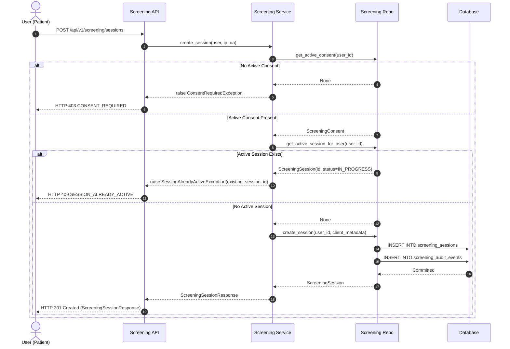

# OptiGuide — Phase 3.1 Consent & Screening Session Architecture

**Document:** `docs/backend/PHASE_3_1_CONSENT_ARCHITECTURE.md`  
**Status:** COMPLETE & VERIFIED  
**Audience:** Backend Engineers, Mobile/Web Engineers, Security Auditors, Clinical Compliance Officers  

---

## 1. Executive Summary

OptiGuide is a cross-platform preliminary vision screening and eyewear guidance platform. It is strictly **non-diagnostic** and does not issue ophthalmic prescriptions or medical diagnoses.

Phase 3.1 establishes the foundational consent management and screening session lifecycle subsystems. Every screening interaction requires an active, cryptographically verified consent document version acceptance. The screening session subsystem enforces strict state transitions, single-active-session concurrency, and comprehensive audit event tracking.

---

## 2. Consent Management Architecture

### 2.1 Cryptographic Versioning & Integrity

The consent document text is hardcoded on the server as the canonical source of truth:
- **Current Version:** `1.0.0`
- **Integrity Algorithm:** SHA-256
- **Normalized Canonical Text:** Trimmed UTF-8 string containing the full legal and non-diagnostic disclaimers.
- **Computed Hash:** `ea78d46e3db2b07e74853059dbe888b50df3650ea9599fb42bfae21db7c25cf6`

Clients cannot submit arbitrary legal text. Clients submit the version string they are agreeing to (`"version": "1.0.0"`). The server verifies:
1. Version matches active server version (`1.0.0`).
2. Server verifies that the current document hash matches the expected hash.

```mermaid
flowchart TD
    Client["Client App"] -->|1. GET /api/v1/screening/consent/current| SrvCurrent["Screening Service"]
    SrvCurrent -->|Returns version 1.0.0, text, hash, user consent state| Client
    Client -->|2. POST /api/v1/screening/consent/accept\n{version: '1.0.0'}| SrvAccept["Consent Accept Endpoint"]
    SrvAccept --> CheckVer{"version == '1.0.0'?"}
    CheckVer -->|No| ErrVer["HTTP 400 INVALID_CONSENT_VERSION"]
    CheckVer -->|Yes| CheckActive{"Active consent already exists?"}
    CheckActive -->|Yes| ReturnExisting["Idempotent Return Existing Record"]
    CheckActive -->|No| PersistConsent["Persist ScreeningConsent\nis_active=True, agreed_at=NOW()"]
    PersistConsent --> LogAudit["Write Audit Event: CONSENT_ACCEPTED"]
    LogAudit --> Success["HTTP 201 Consent Accepted"]
```

### 2.2 Idempotency & Re-acceptance

If a user already has an active consent for version `1.0.0` and submits an acceptance request again, the system handles it idempotently:
- No duplicate active consent record is created.
- The existing consent record is returned with HTTP 200/201.
- Audit event is logged noting the idempotent confirmation.

### 2.3 Consent Withdrawal & Cascade Invalidation

Users have the statutory right (e.g., GDPR, CCPA, HIPAA privacy guidelines) to withdraw consent at any time. When a user withdraws consent:
1. All active consent records for that user are updated to `is_active = False` with `withdrawn_at = utcnow()`.
2. **Cascade Cancellation:** Any `IN_PROGRESS` screening session owned by the user is automatically transitioned to `CANCELLED` with `cancellation_reason = "consent_withdrawn"`.
3. An immutable audit event (`CONSENT_WITHDRAWN`) is recorded with user IP, user agent, and timestamp.
4. Future attempts to start a screening session are immediately blocked (`HTTP 403 CONSENT_REQUIRED`) until fresh consent is accepted.

---

## 3. Screening Session Lifecycle Architecture

### 3.1 State Machine

Screening sessions have a strictly bounded lifecycle governed by the `ScreeningSessionStatus` enumeration:

```
[NONE] ──(POST /sessions)──> IN_PROGRESS ──(POST /sessions/{id}/complete)──> COMPLETED
                                    │
                                    └──(POST /sessions/{id}/cancel)────> CANCELLED
```

#### Allowed State Transitions:
- `None` $\to$ `IN_PROGRESS`: Created via `POST /api/v1/screening/sessions` (requires active consent).
- `IN_PROGRESS` $\to$ `COMPLETED`: Triggered via `POST /api/v1/screening/sessions/{id}/complete`. Sets `completed_at = utcnow()`.
- `IN_PROGRESS` $\to$ `CANCELLED`: Triggered via `POST /api/v1/screening/sessions/{id}/cancel` (with cancellation reason) OR cascade cancellation on consent withdrawal. Sets `cancelled_at = utcnow()`.

#### Strictly Forbidden States and Transitions:
- `COMPLETED` $\to$ `IN_PROGRESS` or `CANCELLED` (Terminal state).
- `CANCELLED` $\to$ `IN_PROGRESS` or `COMPLETED` (Terminal state).
- `DIAGNOSED` or `PRESCRIBED`: Rejected at the schema, database, and business logic levels. OptiGuide provides preliminary screening guidance, never medical prescriptions.

Attempting an invalid transition raises `InvalidSessionTransitionException` (`HTTP 400 INVALID_SESSION_TRANSITION`).

### 3.2 Single-Active-Session Concurrency Model

A user may only have **one** active (`IN_PROGRESS`) screening session at any given moment.

When `POST /api/v1/screening/sessions` is invoked:
1. Active consent check: If no active consent, returns `HTTP 403 CONSENT_REQUIRED`.
2. Active session query: `ScreeningRepository.get_active_session_for_user(db, user_id)`.
3. If an active session exists:
   - System returns `HTTP 409 Conflict` with error code `SESSION_ALREADY_ACTIVE`.
   - The payload provides the existing active `session_id` so the client can resume or cancel it.
4. If no active session exists:
   - A new session is created with UUID primary key, `status = IN_PROGRESS`, `started_at = utcnow()`.
   - Audit event `SESSION_CREATED` is emitted.



---

## 4. Audit Trail & Compliance

To satisfy medical software, GDPR, and data protection requirements, all state-changing operations write to an append-only `screening_audit_events` table:

| Event Type | Trigger | Captured Metadata |
| :--- | :--- | :--- |
| `CONSENT_ACCEPTED` | User accepts legal disclaimer | Consent ID, version (`1.0.0`), document hash, client IP, user agent |
| `CONSENT_WITHDRAWN` | User revokes consent | Consent ID, timestamp, cascade cancellations triggered |
| `SESSION_CREATED` | New session initialized | Session ID, device client metadata, timestamp |
| `SESSION_COMPLETED` | Screening completed | Session ID, completion duration, timestamp |
| `SESSION_CANCELLED` | User or system cancelled session | Session ID, cancellation reason (`user_cancelled`, `consent_withdrawn`, `app_timeout`), timestamp |

All audit events are immutable; the repository provides write and query methods, with no delete or update paths.

---

## 5. Non-Diagnostic Architectural Boundary

OptiGuide explicitly segregates screening data from ophthalmic diagnosis:
1. **Terminology Safeguard:** Statuses like `DIAGNOSED`, `PRESCRIBED`, and fields like `sphere_od`, `cylinder_os` are strictly forbidden in Phase 3.1 entities.
2. **Disclaimer Enforcement:** The consent text clearly articulates that OptiGuide provides functional visual screening and questionnaire-based guidance, and advises consultation with a certified optometrist or ophthalmologist.
3. **Audit Evidence:** The consent document hash stored with each record proves the patient acknowledged these boundaries before entering any screening workflow.
