# OptiGuide — Phase 2.1 Completion Report
## Authentication Security Hardening, Code Audit & Verification

**Project:** OptiGuide Preliminary Vision Screening and Eyewear Guidance  
**Lead Roles:** Principal Backend Architect, Senior Application Security Engineer, Database Architect, QA Automation Lead  
**Date:** November 3, 2026  
**Status:** COMPLETE (All Acceptance Criteria Verified)  
**Report Path:** `docs/phase-reports/PHASE_2_1_REPORT.md`  

---

## 1. Phase Overview

Phase 2.1 conducted an independent security audit, remediation, and verification of the Phase 2 Authentication, Authorization & User Management foundation.

### Scope & Objectives:
- Perform an exhaustive source-code security audit of registration, login, token rotation, and RBAC.
- Remediate privilege escalation vulnerabilities in public registration and profile updates.
- Enforce clinical verification gates for eye-care professionals before accessing screening review features.
- Harden the sliding-window rate limiter against `X-Forwarded-For` IP spoofing.
- Implement atomic conditional refresh token rotation with concurrency race safety.
- Eliminate timing and status leakages that enabled email enumeration.
- Implement strict JWT validation and DoS boundary protections for password hashing.
- Add regression tests covering all 12 required security categories.

---

## 2. Repository Changes

### 2.1 Files Created
- `backend/tests/unit/test_phase2_1_security_unit.py` (14 unit tests)
- `backend/tests/api/test_phase2_1_security_hardening.py` (18 API integration tests)
- `docs/backend/PHASE_2_1_SECURITY_AUDIT.md` (audit findings & threat model)
- `docs/backend/PHASE_2_1_REMEDIATION_REPORT.md` (remediation details & evidence)
- `docs/phase-reports/PHASE_2_1_REPORT.md` (this phase completion report)

### 2.2 Files Modified
- `backend/app/core/config.py`: Added proxy trust controls, password length limits, and refresh grace configurations.
- `backend/app/schemas/auth.py`: Added canonical `UserRole` enum, `extra="forbid"`, registration role guard, and camelCase aliases.
- `backend/app/core/security.py`: Added `DUMMY_ARGON2_HASH`, password max length check, UUID check, and required JWT claims.
- `backend/app/api/dependencies.py`: Hardened IP extraction, created rate-limiter abstraction, added `require_verified_professional`.
- `backend/app/repositories/session_repo.py`: Implemented atomic conditional update `rotate_session_atomic` and PostgreSQL row locking.
- `backend/app/services/auth_service.py`: Fixed role assignment, login password-first checking, timing equalization, and atomic rotation.
- `backend/app/services/user_service.py`: Added role normalization on status updates.
- `backend/app/api/v1/users.py`: Added `GET /api/v1/users/clinical/review-access` endpoint.
- `backend/tests/api/test_auth_api.py`: Updated test user role setup to reflect hardened public registration.
- `backend/tests/api/test_users_api.py`: Updated admin test user setup to reflect hardened public registration.
- `backend/.env.example`: Documented new security configuration settings.
- `shared/types/user.ts`: Added canonical roles and API response contracts.

---

## 3. Implementation Details

```mermaid
flowchart TD
    subgraph Public Registration
        ReqRegister["POST /api/v1/auth/register"] --> ValidatorRole["Pydantic Validator: Reject Privileged Roles"]
        ValidatorRole -->|role in admin, optometrist, shopkeeper| Reject422["422 Validation Error"]
        ValidatorRole -->|Standard user payload| DefaultRole["Unconditionally assign role='patient'"]
        DefaultRole --> HashArgon2["Argon2id Hash (max 128 chars)"]
        HashArgon2 --> DBUser["Persist User in DB"]
    end

    subgraph Authentication & Anti-Enumeration
        ReqLogin["POST /api/v1/auth/login"] --> CheckUserExists{"User Exists?"}
        CheckUserExists -->|No| DummyArgon2["Argon2id Verify(DUMMY_ARGON2_HASH)"]
        DummyArgon2 --> Generic401["401 'Invalid email or password'"]
        CheckUserExists -->|Yes| VerifyReal["Argon2id Verify(user.hashed_password)"]
        VerifyReal -->|Wrong Password| Generic401
        VerifyReal -->|Correct Password| CheckActive{"user.is_active?"}
        CheckActive -->|False| Forbidden403["403 'USER_INACTIVE'"]
        CheckActive -->|True| IssueTokens["Issue 15m JWT + Hashed Refresh Session"]
    end

    subgraph Refresh Token Atomic Rotation
        ReqRefresh["POST /api/v1/auth/refresh"] --> CheckRevoked{"session.is_revoked?"}
        CheckRevoked -->|True| ReplayAttack["Trigger Reuse Detection: Revoke All Sessions"]
        CheckRevoked -->|False| AtomicUpdate["UPDATE user_sessions SET is_revoked=true WHERE is_revoked=false"]
        AtomicUpdate -->|rowcount == 0| ConcurrentRace["Reject in-flight duplicate (no account nuke)"]
        AtomicUpdate -->|rowcount == 1| IssueNewPair["Issue New Access + Refresh Token"]
    end
```



### 3.1 Security & Gating Rules
1. **Public Registration Guard:** Public registration strictly permits standard user accounts (`patient`/`user`). Privileged roles (`admin`, `optometrist`, `eye_care_professional`, `shopkeeper`) cannot be self-assigned under any circumstance.
2. **Clinical Review Gating:** `require_verified_professional` blocks unverified eye-care professionals from accessing clinical review capabilities. Admin accounts retain emergency access.
3. **Anti-Spoofing IP Detection:** `get_client_ip` ignores `X-Forwarded-For` unless `TRUST_FORWARDED_FOR` is explicitly enabled and the direct connection originates from `TRUSTED_PROXIES`.
4. **Login Anti-Enumeration:** Non-existent emails trigger constant-time dummy Argon2id hash checks (~25ms) matching valid user verification times. Passwords are confirmed *before* checking account active status.
5. **Atomic Concurrency Protection:** `SessionRepository.rotate_session_atomic` uses conditional updates to prevent double-rotation in concurrent races without destroying valid user sessions.

---

## 4. Testing & Verification

### Exact Commands Executed:
```powershell
# 1. Full Pytest Suite (97 tests)
backend/.venv/Scripts/python -m pytest backend/tests -v --tb=short

# 2. Ruff Linter & Formatter Check
backend/.venv/Scripts/ruff format backend; backend/.venv/Scripts/ruff check backend

# 3. Universal Frontend Jest Suite (13 tests)
npm run frontend:test

# 4. Alembic Migration Lifecycle Cycle
Set-Location backend; .venv/Scripts/python -m alembic downgrade -1; .venv/Scripts/python -m alembic upgrade head; Set-Location ..
```

### Test Results Summary:
- **Pytest:** 97 passed, 0 failed in 3.69s.
  - Phase 1 Baseline: 36 tests passing.
  - Phase 2 Baseline: 29 tests passing.
  - Phase 2.1 Security Tests: 32 tests passing.
- **Ruff:** All checks passed across 54 files. 100% formatted.
- **Jest:** 13 passed, 0 failed (3 test suites: components, apiClient, tokens).
- **Alembic:** Downgrade to `001_initial_baseline` and upgrade to `002_user_and_auth` succeeded cleanly.

---

## 5. Known Issues & Limitations

1. **PostgreSQL Environment Live Test:**
   - The development workstation has `postgresql-x64-18` service running, but the local port 5432 is not accepting connections with default credentials.
   - Dual-dialect compatibility was verified via SQLite in-memory engine and static SQL inspection of Alembic migrations. Full PostgreSQL integration tests must be executed in CI with a live container.
2. **In-Memory Rate Limiting Scope:**
   - The sliding-window rate limiter stores timestamps in-memory. In multi-worker Uvicorn setups or clustered containers, rate limits apply per-worker.
   - The architecture introduces `BaseRateLimiter` so a Redis-backed engine can be plugged in seamlessly for distributed deployments.

---

## 6. Phase 3 Readiness Decision & Recommendation

### Decision: **APPROVED FOR PHASE 3 HANDOFF**

All 16 acceptance criteria for Phase 2.1 are completely satisfied. The authentication, authorization, session management, and clinical verification foundations are robust, verified, and secure.

### Phase 3 Recommendation (OptiGuide Vision Screening Foundation):
- **Objective:** Establish the preliminary vision screening workflow, questionnaire, and eyewear guidance engine.
- **Key Modules to Develop:**
  1. `ScreeningSession` model: Associated with `users.id`, tracking status (`in_progress`, `completed`, `referred`), consent timestamp, and screening metadata.
  2. `VisualAcuityRecord` & `SnellenTestResult` models: Storing test parameters, letter sizes, distance calibration, right/left eye acuity, and clinical referral flags.
  3. Distance calibration service: Camera/face distance calibration routines.
  4. Eyewear guidance catalog (`Frame`, `Brand`, `LensType`) and matching service.
- **Medical Disclaimer Boundary:** Maintain strict separation between preliminary screening guidance and medical diagnostic prescriptions. Only verified clinicians (`require_verified_professional`) may view clinical referral flags.
