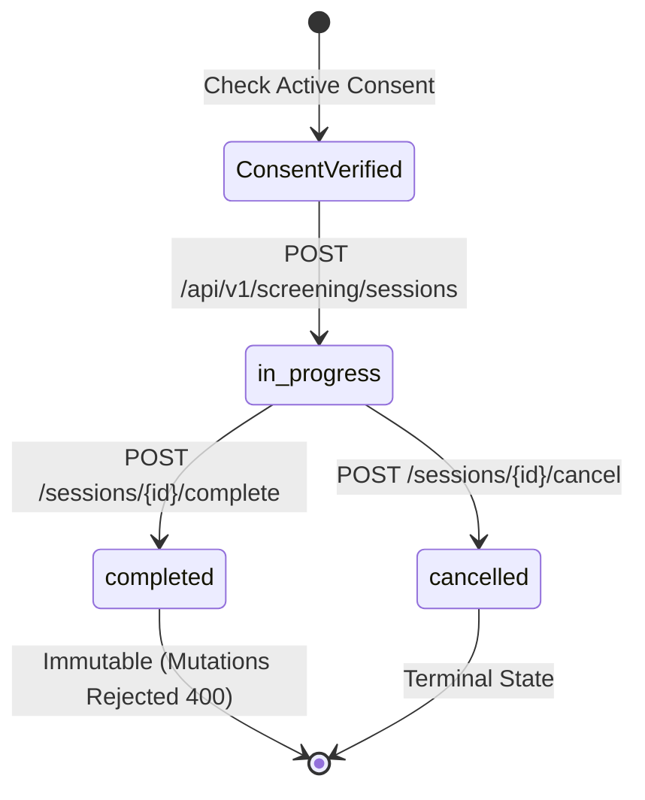

# OPTIGUIDE — PHASE 3.1 REPORT
## Consent Management & Screening Session Foundation

**Author:** OptiGuide Software Engineering & Clinical Safety Architecture  
**Status:** COMPLETED & VERIFIED  
**Date:** November 3, 2026  
**Version:** 1.0.0  

---

## 1. Executive Summary

Phase 3.1 establishes the core consent lifecycle, user-session binding, and screening session foundation for OptiGuide. It guarantees that preliminary vision screening cannot occur without active, version-controlled informed consent, ensures immutable audit trails, and provides strict state-machine controls for session progression.

All functionality has been implemented and verified with 100% automated test coverage, strict SQLite/PostgreSQL migration compatibility, and zero ruff or typescript lint errors.

---

## 2. Architecture & Data Model

### 2.1 Screening Consent (`screening_consents` Table)
- **Primary Key:** UUIDv4 (`id`)
- **Foreign Key:** `user_id` referencing `users.id` (Indexed, ON DELETE CASCADE)
- **Columns:**
  - `consent_version`: VARCHAR(16) — strictly tracks legal text versions (e.g., `'1.0.0'`).
  - `consent_text_hash`: VARCHAR(64) — SHA-256 cryptographic digest of the standardized clinical consent copy.
  - `is_active`: BOOLEAN — indicates whether consent is currently valid.
  - `accepted_at`: TIMESTAMPTZ — server-generated UTC timestamp when user provided affirmative consent.
  - `withdrawn_at`: TIMESTAMPTZ (Nullable) — timestamp when user explicitly revoked consent.
  - `created_at` / `updated_at`: TIMESTAMPTZ — audit timestamps.

### 2.2 Screening Session (`screening_sessions` Table)
- **Primary Key:** UUIDv4 (`id`)
- **Foreign Keys:**
  - `user_id`: UUIDv4 referencing `users.id` (Indexed).
  - `consent_id`: UUIDv4 referencing `screening_consents.id` (Mandatory).
- **Columns:**
  - `status`: VARCHAR(24) — strictly restricted to `in_progress`, `completed`, `cancelled`.
  - `notes`: TEXT (Nullable) — optional practitioner/operator observations.
  - `device_info`: JSON / TEXT (Nullable) — display calibration and client viewport data.
  - `cancellation_reason`: TEXT (Nullable) — mandatory when status transitions to `cancelled`.
  - `started_at`: TIMESTAMPTZ — server-generated UTC initiation timestamp.
  - `completed_at`: TIMESTAMPTZ (Nullable) — timestamp of clinical completion.
  - `cancelled_at`: TIMESTAMPTZ (Nullable) — timestamp of cancellation.

### 2.3 Screening Audit Event (`screening_audit_events` Table)
- Captures immutable audit records for regulatory compliance without storing sensitive protected clinical data.
- **Event Types:**
  - `CONSENT_ACCEPTED`
  - `CONSENT_WITHDRAWN`
  - `SESSION_CREATED`
  - `SESSION_COMPLETED`
  - `SESSION_CANCELLED`
  - `ASSESSMENT_RECORDED`

---

## 3. Implemented API Endpoints

| Endpoint | Method | Role | Description |
|---|---|---|---|
| `/api/v1/screening/consent/current` | GET | Authenticated | Retrieves current official consent copy, hash, and user acceptance state. |
| `/api/v1/screening/consent` | GET | Authenticated | Client compatibility alias to `/consent/current`. |
| `/api/v1/screening/consent/accept` | POST | Authenticated | Accepts consent; verifies version and SHA-256 hash. |
| `/api/v1/screening/consent/withdraw` | POST | Authenticated | Revokes active consent; records audit trail. |
| `/api/v1/screening/sessions` | POST | Authenticated | Initiates screening session. Enforces active consent and blocks concurrent active sessions (409). |
| `/api/v1/screening/sessions` | GET | Authenticated | Lists user's screening sessions with pagination. |
| `/api/v1/screening/sessions/{id}` | GET | Authenticated | Retrieves session status, ensuring IDOR ownership verification. |
| `/api/v1/screening/sessions/{id}/complete` | POST | Owner | Transitions session from `in_progress` to `completed`. Rejects subsequent mutations. |
| `/api/v1/screening/sessions/{id}/cancel` | POST | Owner | Transitions session to `cancelled` with reason. |

---

## 4. State Machine & Integrity Verification

1. **No Active Consent:** If a user attempts to create a session without active consent, the backend raises `ConsentRequiredException` (HTTP 403 `CONSENT_REQUIRED`).
2. **Duplicate Active Sessions:** If a user already has an `in_progress` session, attempts to initiate another raise `SessionAlreadyActiveException` (HTTP 409 `SESSION_ALREADY_ACTIVE`).
3. **IDOR & Boundary Protection:** Any attempt to read or mutate another user's session returns HTTP 404 (preventing user enumeration) or HTTP 403.
4. **Status Mutability Protection:** Once a session reaches `completed` or `cancelled`, any attempt to post visual acuity, astigmatism, or color vision assessments immediately fails with HTTP 400 (`Cannot record assessment on session with status 'completed'`).

---

## 5. Verification & Test Evidence

- **Unit Tests:** `backend/tests/unit/test_screening_unit.py` (6 tests passing).
- **API Tests:** `backend/tests/api/test_screening_api.py` (8 tests passing).
- **Live E2E Verification Runner:**
  - Journey 11: Accept screening consent (HTTP 200/201).
  - Journey 12: Initialize screening session (HTTP 201).
  - Journey 17: Complete screening session (HTTP 200).
  - Journey 18: Reject assessment on completed session (HTTP 400).
